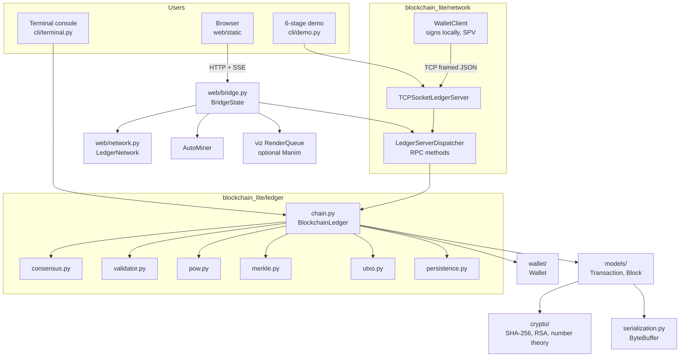

# Architecture

Back to [[Home]]. File-level detail in [[Code Map]].

## Layers (bottom → top)
1. **Foundation** — [[mod - interfaces and serialization]]: constants, exceptions, abstract interfaces, `ByteBuffer`.
2. **Crypto** — [[mod - crypto]]: [[SHA-256]], [[Number Theory and RSA]].
3. **Models** — [[mod - models]]: [[Transactions]], [[Block and Header]].
4. **Wallet** — [[mod - wallet]]: keys, coin selection, signing (client side only).
5. **Ledger** — [[mod - ledger]]: [[UTXO Model]], [[Mempool]], [[Merkle Tree]], [[Proof-of-Work]], [[Difficulty Retargeting]], [[Chain Validation]], [[Fork Resolution]], [[Persistence]].
6. **Network** — [[mod - network]]: TCP RPC server, wallet client, [[SPV Light Client]].
7. **Front ends** — [[mod - cli]], [[mod - web bridge]] + [[mod - web frontend]], [[mod - viz manim]].

## Key design decisions
- **Client/server separation** (`ARC-001`): wallet signs locally; server never sees private keys (any param named `*private_key*` is rejected).
- **Web stuff lives outside the package** (`web/`, `viz/`) so the package stays stdlib-only.
- **Thread safety**: `BlockchainLedger` uses an `RLock` for state and a separate mining lock; nonce search runs *outside* the state lock so reads stay responsive.
- **Atomicity**: UTXO updates are staged on a clone, swapped in only if the whole block is valid.
- **Difficulty is derived from history, never trusted from the block** → [[Difficulty Retargeting]].
- **Single node**: there is one real ledger. The web app *simulates* many peers' copies in-process ([[mod - web network]]).
