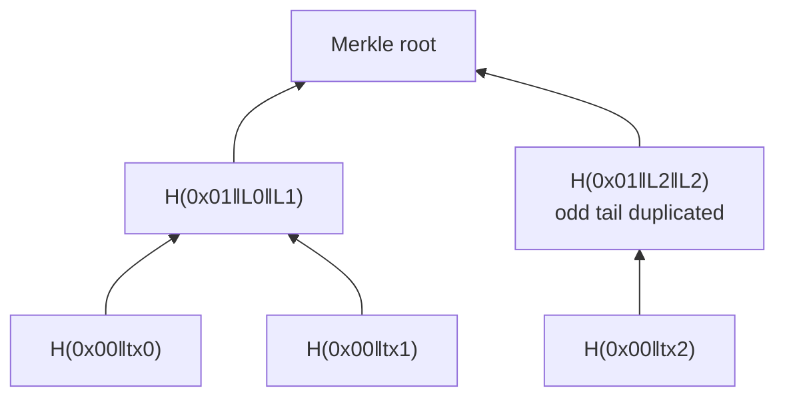

# Merkle Tree

One 32-byte **Merkle root** commits to every transaction in a block. Change any tx → the root changes. File: `ledger/merkle.py`.

- **Leaf** = `H(0x00 ‖ tx_id)`, **internal** = `H(0x01 ‖ left ‖ right)` — domain separation stops passing a leaf off as a node.
- Odd level → last node paired with itself.
- **Proof** = sibling hashes on the path to the root = `⌈log₂ N⌉` hashes (9 txs → 4 hashes). `MerkleProof` / `MerkleProofStep` live in `interfaces.py`.
- `verify_proof` checks LEFT/RIGHT direction against index parity and rejects the **odd-tail spoofing** trick (right sibling equal to current hash) — fix `F-003`.
- `serialize_merkle_proof` / `deserialize_merkle_proof` for the wire.

Used by [[Block and Header]] (root in header) and [[SPV Light Client]].
