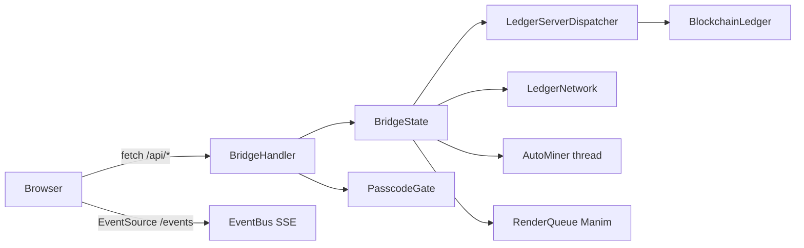

# mod — web bridge

The browser can't speak raw TCP, so `web/bridge.py` is a stdlib `ThreadingHTTPServer` between the browser and the ledger. It lives **outside** the package so `blockchain_lite` stays stdlib-only.

## Pieces
- `EventBus` — pub/sub queues for SSE; heartbeat every 15 s.
- `BridgeState` — holds ledger, demo wallets, names; builds views (`state`, `block_detail`, `merkle_proof`, `forge_trace`, `consensus`) and actions (`send`, `mine`, `tamper`, `add_person`, `tamper_copy`).
- `AutoMiner` — background mining loop (retries with a new timestamp if nonces run out).
- `BridgeHandler` — routing, 64 KiB body cap, static files with traversal blocked.
- Uses the **fast** hash by default (`--bit-level-hash` to switch).

## API
| Method & path | Does |
|---|---|
| `GET /api/state` | chain + consensus info, block summaries, mempool, wallets |
| `GET /api/block?index=N` | header, named txs, Merkle levels |
| `GET /api/proof?block=N&tx=I` | Merkle proof + verify result + path nodes |
| `GET /api/trace?index=N` | everything Block Forge replays (≤ 64 nonce attempts recomputed) |
| `GET /api/network` | everyone's ledger copy |
| `GET /api/renders` | Manim files |
| `GET /events` | SSE: `tx_submitted`, `block_mined`, `retarget`, `auto_miner`, `copy_tampered`, `network_check`, `ledger_repaired`, `person_joined`, `render_ready`, `error` |
| `POST /api/tx` | `{from,to,amount,fee}` sign + submit |
| `POST /api/mine` | mine mempool for Miner, return trace |
| `POST /api/tamper` | `trace_tamper_cascade` on a copy |
| `POST /api/unlock` | passcode check |
| `POST /api/people` | `{name, fund}` new wallet + ledger copy |
| `POST /api/network/tamper` / `audit` | edit a copy / run network check |
| `POST /api/autominer` | start/stop |

## Passcode gate (`web/gate.py`)
`PasscodeGate`: 8 digits, default `12345678` (`--passcode`), compared as salted SHA-256 with `hmac.compare_digest`; **5 wrong → 30 s lockout**. It is a *front door, not access control* — the JSON API stays open on loopback.

CLI flags: `--port`, `--auto-mine`, `--block-time`, `--retarget-interval`, `--audit-interval`, `--bit-level-hash`, `--passcode`, `--render`. Tests: `test_web_bridge`. Back to [[Code Map]].
