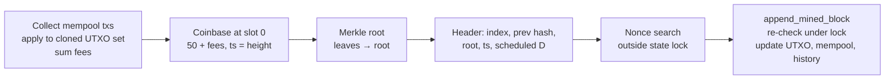

# Life of a Block

`BlockchainLedger.mine_pending_transactions(miner_address)`:

1. **Collect** — every mempool tx, validated against a cloned [[UTXO Model|UTXO set]].
2. **Coinbase** — `block_reward (50) + fees`, height committed.
3. **Merkle root** — [[Merkle Tree]].
4. **Header** — difficulty from the schedule ([[Difficulty Retargeting]]).
5. **PoW** — [[Proof-of-Work]], outside the state lock so reads stay responsive.
6. **Append** — `append_mined_block` re-checks index, link, header/Merkle integrity, PoW, consensus; then updates the UTXO set, drops spent mempool txs, indexes address history.

These five steps are exactly what **Block Forge** animates ([[mod - web frontend]]) and what the Manim scenes render ([[mod - viz manim]]).
