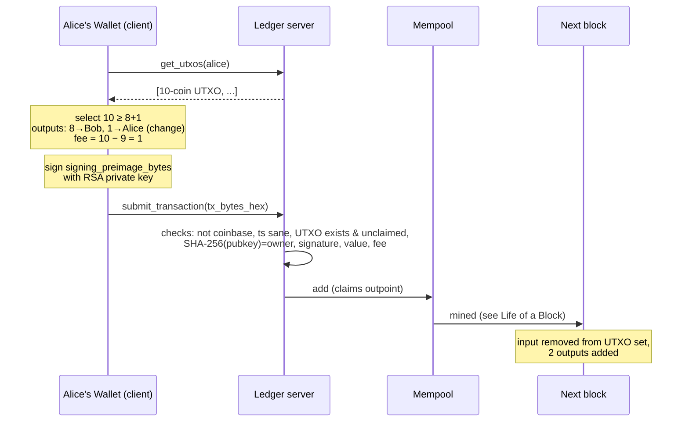

# Life of a Transaction

Example: **Alice sends 8 coins to Bob, fee 1.**

1. **Find coins** — `get_spendable_utxos(alice)` ([[UTXO Model]]).
2. **Build** — `Wallet.create_signed_transfer` ([[mod - wallet]]).
3. **Sign** — over the preimage without signatures ([[Transactions]], [[Number Theory and RSA]]).
4. **Submit** — over TCP or via the web bridge ([[mod - network]]).
5. **Wait** — [[Mempool]].
6. **Mined** — [[Life of a Block]].
7. **Final** — Bob's balance includes 8; inclusion provable with a 4-hash Merkle proof ([[SPV Light Client]]).
