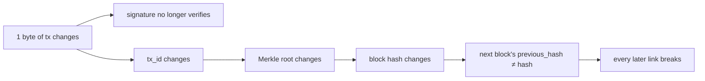

# Tamper Cascade

"Change one byte of one transaction — trace exactly what breaks" (viva Check 2).

- Code: `FullChainValidator.trace_tamper_cascade` → `TamperCascadeReport`; `BlockchainLedger.trace_tamper_cascade`.
- Fixing it means re-mining that block **and every block after it** — and out-working the honest chain ([[Fork Resolution]]).
- Terminal: menu **7**. Web: `POST /api/tamper` (works on a copy) and the **Tamper Lab** ([[mod - web network]]).

Related: [[Block and Header]], [[Chain Validation]], [[Attack Defenses]].
